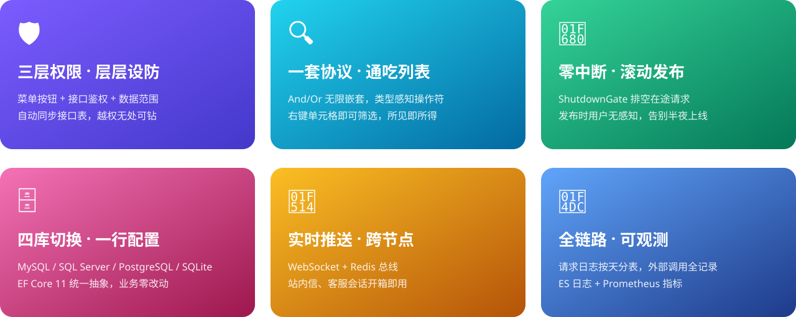
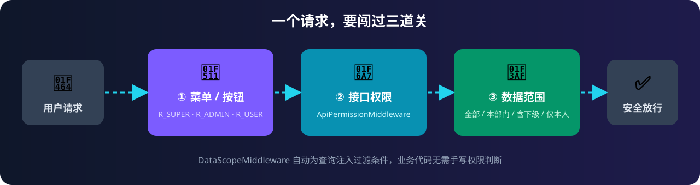
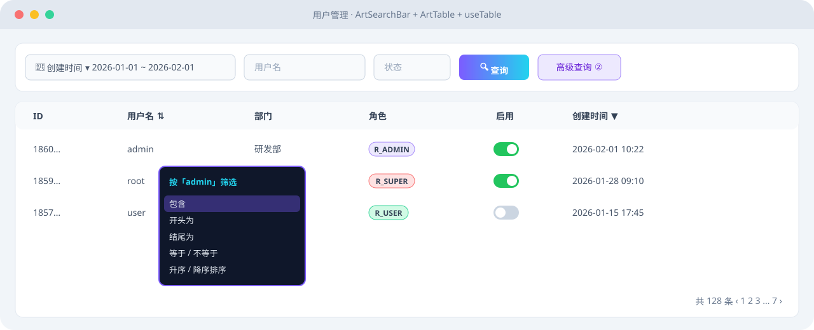
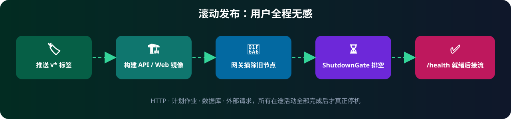
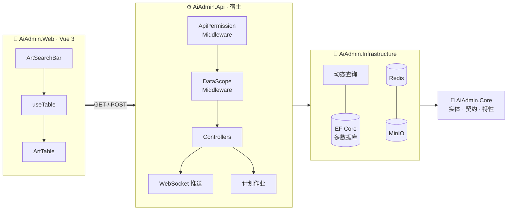

<div align="center">



<br/>

**别再重复造后台了。**
**AiAdmin 把权限、列表、日志、发布这些「每个项目都要做、做起来又特别烦」的事，一次做到极致。**

<br/>


[🚀 三分钟启动](#-三分钟启动) &nbsp;·&nbsp; [✨ 为什么选它](#-为什么选-aiadmin) &nbsp;·&nbsp; [🏛️ 架构](#️-架构一眼看懂)
&nbsp;·&nbsp; [📁 目录](#-目录结构) &nbsp;·&nbsp; [📐 开发约定](AGENTS.md) &nbsp;·&nbsp; [📝 更新日志](CHANGELOG.md)

</div>

<br/>

## 🔥 一眼看懂

<div align="center">

</div>

<br/>

## ✨ 为什么选 AiAdmin

> 大多数后台模板只给你一堆页面，剩下的权限、查询、发布、日志都要自己啃。
> AiAdmin 反过来：**先把难的做成基础设施，再让业务只写业务。**

### 🛡️ 权限：三层叠加，业务代码零判断

菜单按钮、接口、数据范围各管一层，**越权请求在到达控制器之前就已被拦下**。启动时自动扫描并同步接口表，新增接口无需手工登记。

<div align="center">

</div>

### 🔍 列表：一套协议，写一次用一辈子

新增一个列表页，**后端只需声明实体特性，前端只需配置列**。基础筛选、高级嵌套查询、保存查询、右键单元格筛选、服务端排序、分页、导出（Excel / JSON，由 `ListExport`
公共流程统一处理上限，受 `export` 按钮权限控制）——全部开箱即用，且共享同一棵
`dynamicFilter` 树，永不「界面和请求不一致」。

<div align="center">

</div>

<details>
<summary><b>👀 看看请求长什么样</b></summary>

```jsonc
// POST /{resource}/list
{
  "current": 1,
  "size": 20,
  "sortField": "CreatedAt",
  "sortOrder": "desc",
  "dynamicFilter": {
    "logic": "And",
    "filters": [
      { "field": "CreatedAt", "operator": "DateRange", "value": ["2026-01-01", "2026-02-01"] },
      { "logic": "Or", "filters": [
        { "field": "UserName", "operator": "Contains", "value": "admin" },
        { "field": "IsEnabled", "operator": "Equals", "value": true }
      ]}
    ]
  }
}
```

- 无效字段 / 操作符 / 值类型一律返回明确错误，**绝不悄悄忽略条件后返回「看起来正常」的错误数据**
- `GET {resource}/filter-fields` 由实体 `ListFilterAttribute` 驱动，前端不硬编码任何筛选控件
- 日期范围统一左闭右开，布尔 / 数值保持原生 JSON 类型

</details>

### 🚀 发布：上线不再是一场冒险

`ShutdownGate` 记录所有在途的 HTTP、计划作业、数据库与外部请求；滚动发布时网关先摘流，**排空后才真正停机**，`/health` 存活、`/ready` 实测数据库与 Redis
往返并预热连接池后再接入流量，放回网关后还会观察稳定性才处理下一个节点。

<div align="center">

</div>

### 🧰 还有这些，别人要装一堆插件才有的

|    | 能力             | 你得到什么                                                                                                                                        |
|:--:|------------------|---------------------------------------------------------------------------------------------------------------------------------------------------|
| 🗄️ | **四库一键切换** | MySQL / SQL Server / PostgreSQL / SQLite，改 `Database:Provider` 即可                                                                             |
| 🔔 | **实时推送**     | WebSocket + Redis 总线跨节点转发，内置站内信与客服会话                                                                                            |
| 📜 | **日志体系**     | 控制台 / 文件 / Elasticsearch 三路输出；API 请求日志经 Redis 队列**按天分表**入库                                                                 |
| 🔭 | **外呼可追溯**   | 所有对外 HTTP 必经 `ExternalHttpRequestService`，地址、请求体、响应、耗时全记录                                                                   |
| 🙈 | **日志脱敏**     | 请求与外呼日志中的密码、令牌、密钥统一替换为 `***`，凭据不会写入日志和 Elasticsearch                                                              |
| 📈 | **监控就绪**     | 内置 Prometheus 指标、ECharts 仪表盘（运营与请求统计合并为一次缓存读取）、普通用户首页的常用功能磁贴、Redis 条目查看                              |
| 🆔 | **雪花主键**     | 52 位 Snowflake ID，十进制约 15 位，**前端 JS 数字零精度丢失**                                                                                    |
| ⏰ | **计划作业**     | Redis 分布式锁，多实例部署也不会重复触发；失败、超时、耗时过长、**响应体命中文本 / 数字 / 正则规则**可经 Telegram 报警                            |
| 🚨 | **告警监控**     | 监控字典值或 Redis 键的值、长度，支持数字、字符串与**正则匹配**，命中阈值报警、恢复后发送解除通知                                                 |
| 🚦 | **接口限流**     | 滑动窗口 / 漏桶 / 令牌桶三种算法，按全局、角色、用户分层生效，接口管理页右键即可添加                                                              |
| 🔌 | **接口熔断**     | 按窗口内失败率与慢调用熔断，半开试探恢复；返回 429 而非 502/503，避免网关误摘节点；规则缓存读库失败自动退避                                       |
| 🔑 | **API Key**      | 个人中心生成并重置，明文只显示一次；请求头带 `X-Api-Key` 即可鉴权，密码、资料等敏感接口仍只认 JWT（`JwtOnly`），程序调用统一用 API Key            |
| ✍️ | **请求签名**     | 系统设置开启后，鉴权请求必须带 `X-Timestamp`、`X-Nonce`、`X-Signature`（HMAC-SHA256），时间窗口与一次性 Nonce 防重放，签名 Secret 随 API Key 生成 |
| 🎫 | **双令牌续签**   | 访问令牌短期有效，配合刷新令牌自动续签，设有最长会话时长；前端并发请求只触发一次续签                                                              |
| ♻️ | **请求幂等**     | 创建类接口标注 `Idempotent`，带 `Idempotency-Key` 头的重复请求直接回放首次成功的结果；不带该头的调用不受影响，Redis 故障时放行                    |
| 🟢 | **在线状态**     | 用户列表实时显示在线与最后在线时间，多实例间状态一致，崩溃遗留的在线标记由校正作业清理                                                            |
| 🌏 | **中英双语**     | 界面文案、服务端消息、接口描述全接入 i18n；框架与业务分文件，**合并上游不冲突**                                                                   |
| 🧪 | **工程化门禁**   | 0 警告 0 错误、xUnit 测试、认知复杂度阈值、Prettier + ReSharper 一键清理                                                                          |

<br/>

## 🧱 技术栈

<table>
<tr><td><b>⚙️ 后端</b></td><td>

`.NET 11` · `ASP.NET Core` · `EF Core 11` · `StackExchange.Redis` · `JWT Bearer` · `BCrypt` · `MinIO` · `MailKit` · `Magick.NET` · `prometheus-net`

</td></tr>
<tr><td><b>🎨 前端</b></td><td>

`Vue 3.5` · `Vite 8` · `TypeScript 7` · `Element Plus` · `Pinia` · `vue-router` · `vue-i18n 11` · `Tailwind CSS` · `ECharts 6` · `Ace` / `WangEditor`

</td></tr>
<tr><td><b>💾 数据</b></td><td>

`MySQL 8.4` · `SQL Server` · `PostgreSQL` · `SQLite` · `Redis` · `Elasticsearch`

</td></tr>
<tr><td><b>📦 部署</b></td><td>

`Docker` · `Docker Compose` · `Nginx 网关` · `Gitea Actions 滚动发布`

</td></tr>
</table>

## 🏛️ 架构一眼看懂



三个后端项目**单向引用** `Api → Infrastructure → Core`，天然形成增量编译边界：只改 API 层，不会重编 Core 与 Infrastructure。

## 🚀 三分钟启动

**环境要求**：.NET SDK 11（见 `global.json`）· Node.js 20.19+ · MySQL 8.4 · Redis

```powershell
# 1️⃣ 后端  →  http://localhost:5678
dotnet run --project src/AiAdmin.Api --launch-profile dev

# 2️⃣ 前端  →  http://localhost:5679
cd src/AiAdmin.Web
cnpm install
cnpm run dev -- --no-open
```

> 🔑 种子账号：`root` / `job` / `admin` / `user`，初始密码均为 `1234qwer`，**首次登录后请立即修改**。

开发环境首次启动会**自动建表并写入角色、菜单和用户种子数据**，无需手工初始化。

<details>
<summary><b>⚙️ 配置要点</b></summary>

- 默认 MySQL，通过 `Database:Provider` 切换 `sqlserver` / `postgresql` / `sqlite`；开发环境需先创建 `utf8mb4` 数据库和用户
- 敏感配置（连接串、Redis、MinIO、SMTP）写入 `src/AiAdmin.Api/appsettings.Local.json`（已排除 Git，参考 `appsettings.Local.example.json`）或环境变量，如
  `ConnectionStrings__MySQL`
- `Production` 不自动初始化，见 [docker/README.md](docker/README.md)
- 部署前**必须**覆盖 `Jwt:Key`、`Encryption:Key` 与各类密码；多实例必须为每个实例设置不同的 `Snowflake:WorkerId`（0–31）

</details>

<details>
<summary><b>🏁 启动参数</b></summary>

| 参数                        | 作用                                                                 |
|-----------------------------|----------------------------------------------------------------------|
| `--enabled-hosted-services` | 启用计划作业、Elasticsearch 日志、API 请求日志入库等后台服务         |
| `--clear-database`          | 仅开发 / 测试：清空所有表后重新初始化（同义：`--delete-all-tables`） |
| `--replace-job-request-url` | 覆盖计划作业的请求地址                                               |

多实例部署时只让部分实例启用后台服务，作业执行通过 Redis 锁避免重复触发。

</details>

## 🧩 开箱即用的功能

<div align="center">

`👥 用户` `🎭 角色` `🏢 部门` `📋 菜单` `🔌 接口` `🎯 数据权限` `📚 字典` `⏰ 计划作业` `📁 文件`
`✉️ 站内信` `💬 客服会话` `⚙️ 系统设置` `🔐 登录日志` `📜 系统日志` `🌐 请求日志` `🧠 Redis 条目` `🚨 告警监控` `🚦 接口限流` `🔌 接口熔断` `🔑 API Key`
`✍️ 请求签名` `🙋 个人中心` `🧩 常用功能` `📊 仪表盘`

</div>

## 📁 目录结构

| 目录                                                               | 说明                                                     |
|--------------------------------------------------------------------|----------------------------------------------------------|
| [src/AiAdmin.Core](src/AiAdmin.Core/README.md)                     | 实体模型、契约、特性、雪花 ID 等共享类型，不依赖其他项目 |
| [src/AiAdmin.Infrastructure](src/AiAdmin.Infrastructure/README.md) | 数据库、动态查询、权限与数据范围、令牌、对象存储         |
| [src/AiAdmin.Api](src/AiAdmin.Api/README.md)                       | 应用宿主：控制器、中间件、日志、计划作业、实时推送       |
| [src/AiAdmin.Web](src/AiAdmin.Web/README.md)                       | 前端应用                                                 |
| [tests](tests/README.md)                                           | 后端 xUnit 测试                                          |
| [build](build/README.md)                                           | 代码清理、质量规则、版本标签脚本                         |
| [docker](docker/README.md)                                         | 镜像构建、编排、网关与滚动发布                           |
| [.gitea/workflows](.gitea/workflows/README.md)                     | Gitea Actions 发布流水线                                 |
| [docs](docs/README.md)                                             | 业务设计与设计稿                                         |

<details>
<summary><b>🎨 前端目录结构</b></summary>

```
src/AiAdmin.Web/src
├─ api/            接口函数与类型（system-manage 框架 / business-manage 业务）
├─ components/     core（框架通用组件）、business（业务组件）
├─ hooks/core/     组合式函数，useTable 是列表页核心
├─ locales/        langs（框架语言包）、business（业务语言包）
├─ router/         静态路由、动态路由注册、守卫
├─ store/          Pinia 状态
├─ utils/          http、i18n、table、json（动态查询）、realtime、socket
└─ views/          system（框架页面）、business（业务页面）
```

菜单由后端 `menu-seed.json` 下发，`component` 对应 `views` 下目录；新增页面需同步菜单种子、路由权限与 i18n。

</details>

## 🛠️ 构建、测试与发布

```powershell
dotnet build                          # 要求 0 警告 0 错误
dotnet test tests/AiAdmin.Tests       # 后端测试
cd src/AiAdmin.Web; npx vite build    # 前端构建验证
./build/code.clean.full.ps1           # 提交前必须运行（Prettier + ReSharper + 换行整理）
```

- **版本**：`standard-version` 生成 `CHANGELOG.md` 并打 `v*` 标签，`./build/new.version.tag.ps1` 提供交互式升级
- **发布**：推送 `v*` 标签触发 Gitea 流水线，构建 API 与 Web 镜像并滚动部署，见 [.gitea/workflows/README.md](.gitea/workflows/README.md)

## 📖 约定与文档

- 📐 开发约定（后端 / 前端 / 统一列表页 / 导出 / 提交流程）：[AGENTS.md](AGENTS.md)
- 🧭 业务设计：[docs](docs/README.md)
- 📝 变更历史：[CHANGELOG.md](CHANGELOG.md)

<br/>

<div align="center">

**如果 AiAdmin 帮你省下了时间，欢迎点一个 ⭐ Star**

<sub>Built with ❤️ on .NET 11 & Vue 3</sub>

</div>